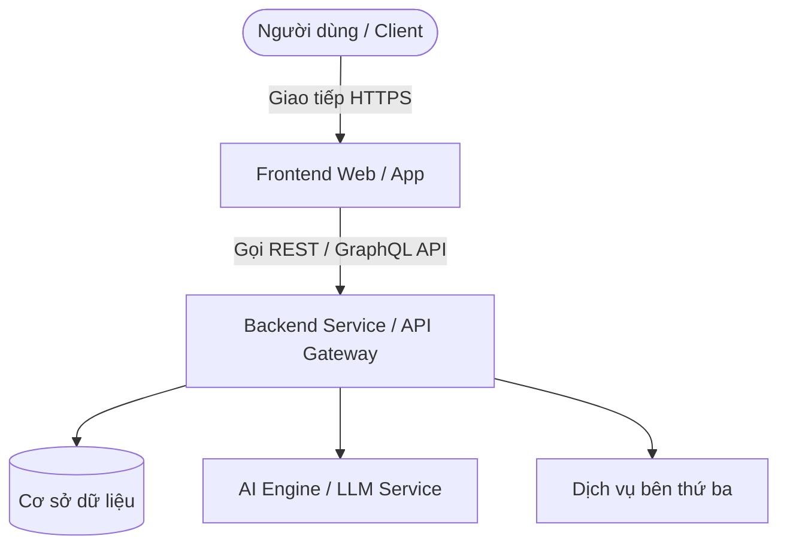

# 🚀 [Tên Dự Án] — [Khẩu Hiệu / Tagline Ngắn Gọn]

> **Dự án nộp bài tại cuộc thi Hackathon 2026**  
> *Một giải pháp đột phá nhằm giải quyết [vấn đề cốt lõi mà dự án hướng tới].*

[](https://opensource.org/licenses/MIT)
[]()
[]()

---

## 📌 Mục Lục
- [1. Giới Thiệu & Bối Cảnh (Problem Statement)](#-1-giới-thiệu--bối-cảnh-problem-statement)
- [2. Giải Pháp (Solution Overview)](#-2-giải-pháp-solution-overview)
- [3. Tính Năng Nổi Bật (Key Features)](#-3-tính-năng-nổi-bật-key-features)
- [4. Kiến Trúc Hệ Thống (Architecture)](#-4-kiến-trúc-hệ-thống-architecture)
- [5. Công Nghệ Sử Dụng (Tech Stack)](#-5-công-nghệ-sử-dụng-tech-stack)
- [6. Hướng Dẫn Cài Đặt & Chạy Thử (Getting Started)](#-6-hướng-dẫn-cài-đặt--chạy-thử-getting-started)
- [7. Liên Kết Demo & Pitching (Demo & Pitch)](#-7-liên-kết-demo--pitching-demo--pitch)
- [8. Thành Viên Nhóm (Team)](#-8-thành-viên-nhóm-team)
- [9. Giấy Phép (License)](#-9-giấy-phép-license)

---

## 🎯 1. Giới Thiệu & Bối Cảnh (Problem Statement)

- **Vấn đề thực tế:** Nêu rõ khó khăn, thách thức hiện tại mà người dùng/thị trường đang gặp phải.
- **Thực trạng:** Tại sao các giải pháp hiện nay chưa đáp ứng tốt hoặc còn thiếu sót?
- **Đối tượng thụ hưởng:** Ai sẽ được hưởng lợi chính từ sản phẩm này?

---

## 💡 2. Giải Pháp (Solution Overview)

**[Tên Dự Án]** được phát triển để mang lại:
1. **Tính tiện dụng & Nhanh chóng:** Giúp người dùng thực hiện tác vụ chỉ với vài thao tác.
2. **Tính thông minh & Tự động hoá:** Tận dụng công nghệ hiện đại (AI / Cloud / Data) để tối ưu hoá quy trình.
3. **Tính mở rộng & Tin cậy:** Kiến trúc hiện đại, khả năng scale linh hoạt.

---

## ✨ 3. Tính Năng Nổi Bật (Key Features)

- [x] **Tính năng 1:** Mô tả ngắn gọn tính năng cốt lõi MVP.
- [x] **Tính năng 2:** Khả năng tương tác / xử lý dữ liệu theo thời gian thực.
- [x] **Tính năng 3:** Dashboard / Báo cáo phân tích trực quan.
- [ ] **Tính năng trong tương lai (Roadmap):** Kế hoạch phát triển sau Hackathon.

---

## 🏗️ 4. Kiến Trúc Hệ Thống (Architecture)



---

## 🛠️ 5. Công Nghệ Sử Dụng (Tech Stack)

| Tầng (Layer) | Công nghệ đề xuất |
| :--- | :--- |
| **Frontend** | React / Next.js / TailwindCSS / Vite |
| **Backend** | Node.js (Express/NestJS) hoặc Python (FastAPI/Django) |
| **Database** | PostgreSQL / MongoDB / Supabase |
| **AI / Machine Learning** | OpenAI API / Google Gemini / HuggingFace |
| **DevOps & Hosting** | Vercel / Docker / GitHub Actions |

---

## ⚡ 6. Hướng Dẫn Cài Đặt & Chạy Thử (Getting Started)

### Yêu cầu tiên quyết (Prerequisites)
- [Node.js](https://nodejs.org/) (phiên bản `>= 18.x`) hoặc [Python](https://www.python.org/) (phiên bản `>= 3.10`)
- Git

### Các bước cài đặt

1. **Clone repository về máy:**
   ```bash
   git clone <URL_REPO_CUA_BAN>
   cd Hackathon
   ```

2. **Cấu hình biến môi trường:**
   ```bash
   cp .env.example .env
   # Mở file .env và điền các API key / cấu hình cần thiết
   ```

3. **Cài đặt thư viện dependencies:**
   ```bash
   # Nếu dự án dùng Node.js:
   npm install
   
   # Nếu dự án dùng Python:
   python -m venv venv
   source venv/bin/activate  # Trên Windows: .\venv\Scripts\activate
   pip install -r requirements.txt
   ```

4. **Khởi chạy ứng dụng ở môi trường Local:**
   ```bash
   # Frontend / Backend Node.js
   npm run dev
   
   # Hoặc Backend Python
   uvicorn main:app --reload
   ```

5. **Truy cập ứng dụng tại:** `http://localhost:3000` (hoặc cổng tương ứng).

---

## 🎥 7. Liên Kết Demo & Pitching (Demo & Pitch)

- **Trang Live Demo:** [https://your-demo-url.com](https://your-demo-url.com) *(Cập nhật link nếu có)*
- **Video Pitch / Giới thiệu sản phẩm (YouTube/Loom):** [Link Video Pitch](https://youtube.com)
- **Slide Thuyết Trình:** [Link Google Slides / Canva](https://canva.com)

---

## 👥 8. Thành Viên Nhóm (Team)

| Họ và Tên | Vai trò | Email / GitHub |
| :--- | :--- | :--- |
| **Quoc Minh** | Leader / Fullstack Developer | [quocminh1297@gmail.com](mailto:quocminh1297@gmail.com) |
| *[Thành viên 2]* | Frontend / UI-UX Designer | [github-link](#) |
| *[Thành viên 3]* | AI Engineer / Data Analyst | [github-link](#) |

---

## 📄 9. Giấy Phép (License)

Dự án được phân phối dưới giấy phép **MIT License**. Xem chi tiết tại [LICENSE](LICENSE).
